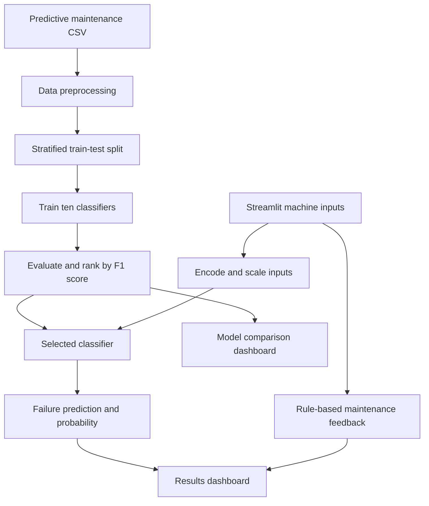

# MachineHealth-AI

**Machine Learning for Predictive Maintenance and Machine Failure Detection**


## Project Overview

MachineHealth-AI is an interactive predictive maintenance application that estimates the likelihood of machine failure from operating conditions. It combines supervised binary classification, model benchmarking, and rule-based maintenance feedback in a Streamlit dashboard.

The project demonstrates how machine learning can support condition monitoring in manufacturing and CNC machine environments. It is an educational adaptation of an existing open-source implementation, rather than a validated industrial monitoring system.

## Key Features

- Interactive input of six machine operating parameters.
- Binary failure prediction with an estimated failure probability.
- Benchmarking of ten machine learning classifiers.
- Automatic selection of the highest-F1 model in the current evaluation split.
- Interactive comparison of model metrics and accuracy visualization.
- Machine health and failure-risk visualization.
- Rule-based alerts and maintenance suggestions for selected operating conditions.

## System Architecture



## Dataset and Input Features

The application uses the synthetic AI4I 2020 predictive maintenance dataset in `predictive_maintenance.csv`. The input measurements represent industrial operating conditions, not live sensor readings.

| Feature | Unit / category | Description |
| --- | --- | --- |
| Machine type | L, M, H | Product quality category |
| Air temperature | K | Ambient operating temperature |
| Process temperature | K | Temperature during machining |
| Rotational speed | rpm | Rotation rate |
| Torque | Nm | Applied rotational load |
| Tool wear | min | Accumulated tool usage |

**Target:** `0` = no failure; `1` = failure.

Reference: [AI4I 2020 dataset on Kaggle](https://www.kaggle.com/datasets/stephanmatzka/predictive-maintenance-dataset-ai4i-2020).

## Machine Learning Pipeline

1. Read the dataset and exclude identifier columns and the failure-type field from the predictors.
2. Encode the categorical machine type and standardize the feature values.
3. Create a stratified 80:20 train-test split using a fixed split seed of 42.
4. Fit ten classifiers and calculate their evaluation metrics.
5. Rank the classifiers by F1-score and select the highest-scoring model for inference.
6. Transform user inputs and return the predicted class and estimated positive-class probability.
7. Present predictions, charts and independent rule-based maintenance feedback in the dashboard.

### Models compared

| Model family | Algorithms |
| --- | --- |
| Linear | Logistic Regression |
| Tree-based | Decision Tree, Random Forest |
| Instance-based | K-Nearest Neighbors |
| Margin-based | Support Vector Machine |
| Probabilistic | Gaussian Naive Bayes |
| Boosting | Gradient Boosting, AdaBoost, XGBoost, LightGBM |

### Evaluation metrics

| Metric | Purpose |
| --- | --- |
| Accuracy | Overall proportion of correct predictions |
| Precision | Proportion of predicted failures that are actual failures |
| Recall | Proportion of actual failures detected |
| F1-score | Harmonic mean of precision and recall |
| ROC-AUC | Ability to distinguish failures from non-failures across thresholds |

Failure events are a minority class, so accuracy alone is insufficient. The application generates its comparison table at runtime. No independently verified numerical performance is claimed here.

## Application Dashboard

After entering the operating parameters and selecting **Predict**, the interface displays the classifier comparison table, selected model, failure classification, probability visualization and maintenance feedback. Existing application screenshots are available in the [pictures directory](pictures/).

The maintenance feedback uses fixed thresholds and is separate from the statistical model; it is not a causal explanation of the model's prediction.

## Technology Stack

| Component | Technology |
| --- | --- |
| Programming | Python |
| Data processing | Pandas, NumPy |
| Machine learning | Scikit-learn, XGBoost, LightGBM |
| Visualization | Matplotlib |
| Web interface | Streamlit |

## Project Structure

```text
MachineHealth-AI/
├── app.py                       # Streamlit interface
├── model.py                     # Preprocessing, training, inference and rules
├── predictive_maintenance.csv   # Input dataset
├── requirements.txt             # Python dependencies
├── pictures/                    # Existing application screenshots
├── LICENSE                      # Upstream license (retain with distribution)
└── README.md                    # Documentation
```

## Installation and Usage

Clone the repository and navigate into the project folder:

```powershell
git clone https://github.com/kannuharpit/MachineHealth-AI.git
cd MachineHealth-AI
```

Create a local virtual environment (Python 3.10 recommended) and install dependencies:

```powershell
python -m venv .venv
.\.venv\Scripts\python.exe -m pip install -r requirements.txt
```

Launch the dashboard:

```powershell
.\.venv\Scripts\python.exe -m streamlit run app.py
```

Open [http://localhost:8501](http://localhost:8501) in your browser. The application trains the models during initialization; no separate training command is required. Keep the dataset in the project root. Press `Ctrl+C` in the terminal to stop the server.

## Technical Contributions

Repository maintainer: **Arpit Gupta**.

Work documented for this adaptation includes configuring the Python environment, resolving setup issues, reproducing the Streamlit application, inspecting training output and class imbalance, and organizing project documentation and launch instructions.

## Limitations and Future Improvements

- Fit scaling and encoding on training data only; the current preprocessing fits the scaler before splitting, which introduces leakage risk.
- Use the fitted categorical encoder at inference instead of a separate hard-coded mapping; the current mapping may disagree with training.
- Use validation or cross-validation for model selection and reserve a separate test set for unbiased evaluation.
- Add confusion matrices, precision-recall curves, and probability calibration checks.
- Label the displayed probability explicitly as failure probability even when the predicted class is no failure.
- Add input validation and evaluate on representative real-world data before any operational use.

This application is intended for learning and demonstration, not for industrial safety decisions or certified maintenance recommendations.

