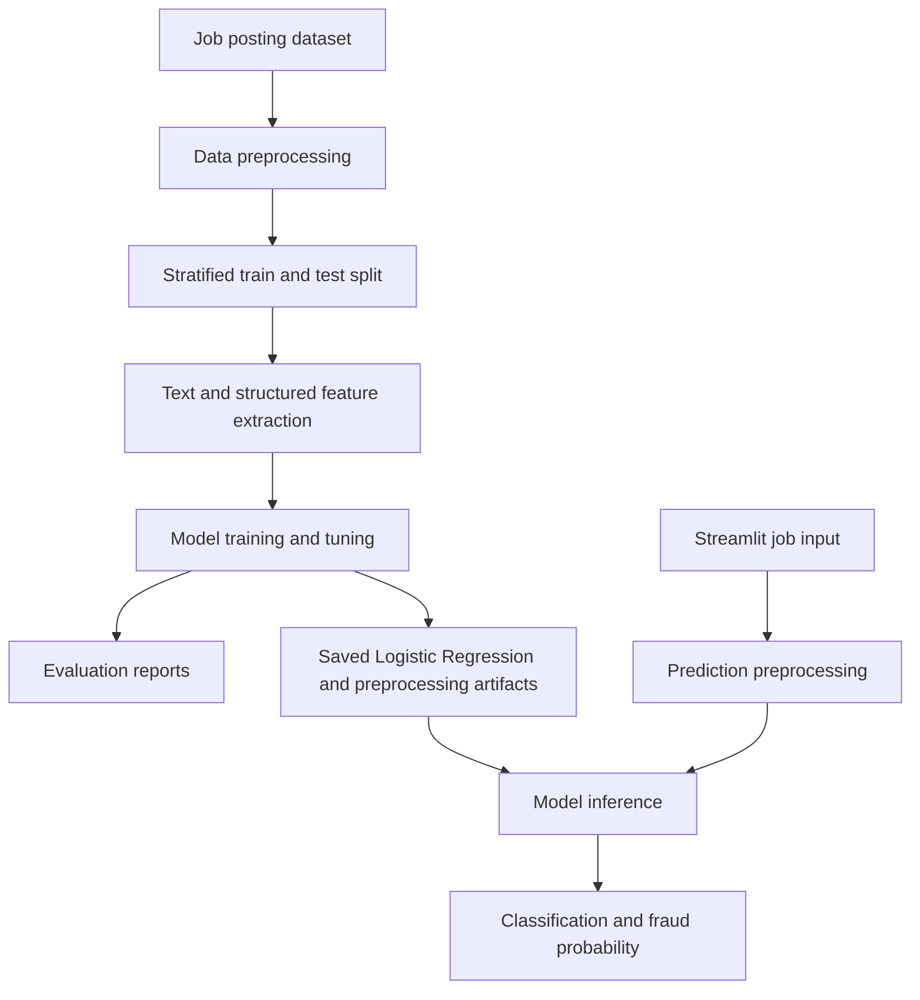

# JobGuard-ML

**Machine Learning and NLP for Job Posting Fraud Detection**


## Overview

JobGuard-ML is a binary classification application that analyzes job advertisements for potential fraud. It combines natural language processing with structured employment information to produce a predicted classification and an estimated fraud probability through an interactive Streamlit interface.

The objective is to explore how supervised learning can support preliminary screening of suspicious job listings while accounting for imbalanced classes and false alarms.

## Key Features

- Interactive form for entering job advertisement details.
- NLP-based text cleaning and numerical feature extraction.
- Combined textual and structured job attributes.
- Comparison of multiple supervised classification algorithms.
- Class-imbalance handling and hyperparameter search.
- Prediction interface with estimated fraud probability.
- Evaluation reports, ROC curves, confusion matrices and feature importance plots.

## System Architecture



## Technology Stack

| Area | Technologies |
| --- | --- |
| Language | Python |
| Data processing | Pandas, NumPy |
| Text representation | TF-IDF, CountVectorizer |
| Machine learning | Scikit-learn, XGBoost |
| Imbalanced learning | imbalanced-learn, SMOTE |
| Model persistence | Joblib |
| User interface | Streamlit |

## Dataset

The demonstration uses generated job advertisements with a schema inspired by the [Real or Fake? Fake Job Posting Prediction dataset](https://www.kaggle.com/datasets/shivamb/real-or-fake-fake-jobposting-prediction) published by Shivam Bansal on Kaggle.

Inputs include job titles, descriptions, qualifications, company information and employment attributes. The target variable is `fraudulent`, with `0` representing a legitimate listing and `1` representing a fraudulent listing.

The bundled synthetic data is intended for experimentation. It should not be confused with the original real-world dataset. See [dataset documentation](data/DATA_SOURCE.md) for source and licensing information.

## Machine Learning Pipeline

The training script uses a stratified 80:20 training/test split. Text vectorizers and feature scaling are fitted using the training partition. SMOTE is applied to a training-data variant, and class weighting is used in several models to address the minority fraud class.

| Algorithm | Role in the pipeline |
| --- | --- |
| Logistic Regression | TF-IDF classification baseline and tuned deployment model |
| Multinomial Naive Bayes | Count-based text classification baseline |
| Random Forest | Tree-ensemble comparison |
| Linear SVM | Linear classifier with probability calibration |
| XGBoost | Boosted-tree comparison |

Randomized hyperparameter search is included for Logistic Regression and XGBoost. The training script exports the tuned Logistic Regression estimator with its associated vectorizer, scaler and structured feature configuration for inference.

## Model Evaluation

The evaluation pipeline measures accuracy, precision, recall, F1-score and ROC-AUC. Fraud-class recall measures how many fraudulent listings are detected; precision reflects how many flagged listings actually belong to the fraud class.

The checked-in [model comparison report](reports/model_comparison.csv) records perfect scores on the demonstration data. These are synthetic-data results, not evidence of perfect real-world detection. Independent validation on authentic job advertisements is needed before drawing practical performance conclusions.

Additional plots and reports are stored in the [`reports/`](reports/) directory.

## Repository Structure

```text
JobGuard-ML/
├── app/
│   └── app.py
├── data/
│   ├── fake_job_postings.csv
│   └── DATA_SOURCE.md
├── models/
├── reports/
├── src/
│   ├── download_data.py
│   ├── eda.py
│   ├── evaluate.py
│   ├── features.py
│   ├── generate_synthetic_data.py
│   ├── predict.py
│   ├── preprocess.py
│   └── train.py
├── requirements.txt
└── README.md
```

## Installation and Usage

### 1. Clone the repository

```powershell
git clone https://github.com/kannuharpit/JobGuard-ML.git
cd JobGuard-ML
```

### 2. Set up the Python environment

The following commands are for Windows PowerShell. Python 3.10 was used for local testing.

```powershell
python -m venv .venv
.\.venv\Scripts\python.exe -m pip install -r requirements.txt
```

### 3. Train the model

```powershell
.\.venv\Scripts\python.exe src/train.py
```

If the demo dataset is missing, run `src/generate_synthetic_data.py` before training. Retrain when serialized model artifacts are incompatible with the installed Scikit-learn version. Only load trusted Joblib or pickle files.

### 4. Launch the application

```powershell
.\.venv\Scripts\python.exe -m streamlit run app/app.py
```

Visit [http://localhost:8501](http://localhost:8501) in your browser. Enter the job information and submit the form to view the predicted label and estimated probability.

## Technical Contributions

**Repository maintainer: Arpit Gupta — M.Tech, Computer Science and Engineering**

- Reproduced the existing ML workflow in a local Python environment.
- Investigated serialized-estimator compatibility problems with Scikit-learn.
- Retrained the classifier and verified the Streamlit prediction workflow locally.
- Examined prediction behavior on sample advertisements, including a possible false positive.
- Improved reproducibility through updated execution and troubleshooting documentation.

## Limitations and Future Work

- Evaluate the classifier on a real-world dataset using an independent holdout set.
- Investigate false positives and false negatives using realistic postings.
- Select an operating threshold based on the precision–recall trade-off.
- Assess generalization to unfamiliar employers, industries and writing styles.

A model prediction is a screening signal, not proof of fraud. The application is a demonstration and should not be used as the sole basis for employment decisions.
